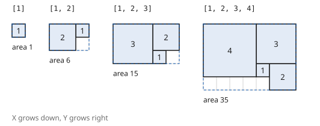
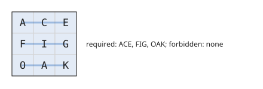
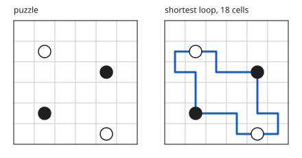
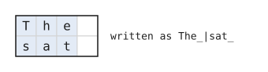

# Questions

Problems by QRT, for the QRT x Imperial "Code. Compute. Compete" hackathon (26 October 2026, on HackerRank).

The statement pages could not be fetched again after the test closed. The text below is the transcription made
during the test, and every diagram is redrawn from the statement's examples. Interactive versions of Q1, Q2, Q4 and
Q5 are in [docs/](docs).

All five were "Approximate Solution" problems: partial credit per hidden test, sample tests not scored. The bonus (Q5)
counted only if every main question scored at least 70%.

| Question | Hidden tests | Points |
|---|---|---|
| [Q1. Square packing](#q1-square-packing) | 100 | 1000 |
| [Q2. Word search generation](#q2-word-search-generation) | 18 | 1080 |
| [Q3. Black box](#q3-black-box) | 51 | 1020 |
| [Q4. Masyu](#q4-masyu) | 100 | 1000 |
| [Q5. Bonus: Document Lego](#q5-bonus-document-lego) | 1 | 200 |

## Q1. Square packing

HackerRank title: "Square packing++".

You are given a list of positive integers [a0, a1, ..., an], where each integer is the side length of a square.
Arrange these squares on a 2D grid such that:

1. No two squares overlap.
2. All square corners have integer coordinates.
3. All sides are parallel to the X and Y axes.
4. The bounding rectangle that contains all squares, aligned with the axes, has the smallest possible area.

Coordinate system: the X axis increases downward and the Y axis increases to the right. Output a list of tuples
[(X0, Y0), ..., (Xn, Yn)], each the top left corner of the square with side ai, in input order.

**Examples**

| Input | Output |
|---|---|
| [1] | [(0,0)] |
| [1,2] | [(0,2),(0,0)] |
| [1,2,3] | [(2,3),(0,3),(0,0)] |
| [1,2,3,4] | [(3,4),(3,5),(0,4),(0,0)] |



*Redrawn from the examples above. The dashed line is the bounding rectangle.*

**Scoring.** The checker reports, for example,
`Valid packing. BoundingArea=1260, LowerBound=1200, Ratio=0.9524, Score=0.3769`.

- A is the area of the smallest rectangle, aligned with the axes, that encloses all squares.
- L is a lower bound. With m the largest side and S the sum of the squared sides,
  L = min over integers W ≥ m of W × max(m, ceil(S / W)).
- Score per test = (L / A)^20. A score of 1 means optimal. The true optimum may exceed L; the test cases are chosen
  so that L is close to achievable.
- An invalid packing (overlap, coordinates that are not integers, wrong number of lines) scores 0.
- The total is the sum over the hidden tests. Sample tests are not scored. Each hidden test was worth 10 points.

Tips from the statement: squares may be placed in any order; the optimal rectangle's shape is not unique, but its
area is; test for overlaps carefully, watching for off by one errors.

**Input and output.** Standard input: n, then n side lengths, one per line. Function: `pack_squares(squares)`,
returning n rows of two integers X and Y. The first sample was the squares 3, 1, 4, 1, 5.

## Q2. Word search generation

You are given two lists of words:

- Required words: every word must appear somewhere in your grid, readable in a straight line in any of the 8 compass
  directions (horizontal, vertical, diagonal; forwards or backwards).
- Forbidden words: none may appear anywhere in the grid, in any direction.

The grid wraps around at the edges (a torus): a word may begin near one edge and continue from the opposite edge, in
any of the 8 directions.

Task: produce the smallest possible square grid (side N) that satisfies both constraints. Every cell is an uppercase
letter, A to Z.

**Example.** Required: ACE, FIG, OAK. Forbidden: none. A valid 3 × 3 output:

```
ACE
FIG
OAK
```



*Redrawn from the example.*

**Scoring** per test:

- S = the total number of letters in the required words
- density = S / N²
- score = 100 × min(1, density / 1.7)

Full marks need every cell to be used by about 2 required words on average, so words must share letters heavily.
Example: S = 500 in a 25 × 25 grid gives density 0.8 and score 47.06; in 20 × 20, density 1.25 and score 73.53.

A test scores 0 if a required word is missing, a forbidden word is present, the grid is not square, a cell is not a
letter, or N is less than the longest required word. HackerRank scaled each hidden test to 60 points.

**Input and output.** Standard input: the number of required words and the words, one per line, then the number of
forbidden words and the words. Function: `generate_grid(required_words, forbidden_words)`, returning the rows as
strings. The first sample was ACE, FIG, OAK with no forbidden words.

## Q3. Black box

The full statement:

> Query the black box to maximise payoff. Beware the noise.
>
> Bonus eligibility uses your official final noiseless score for the whole question. Individual noisy feedback values
> do not determine eligibility. The normalized noisy score is `raw_noisy_score / raw_noiseless_target`, clipped to the
> range 0-1

Function: `probe(t)`. Each test feeds one float t on standard input; return a list of floats, printed one per line.
51 tests, no samples, 20 points each. There was no diagram.

## Q4. Masyu

Masyu is a Nikoli logic puzzle. A rectangular grid of cells has some white (W) or black (B) pearls. Draw a single
closed loop that:

- visits every pearl,
- passes through cell centres, moving only horizontally or vertically (every turn is 90 degrees),
- never crosses itself and never visits a cell twice,
- obeys the pearl rules:
  - White pearl: the loop passes straight through the cell, and turns in at least one of the two adjacent cells along
    the loop.
  - Black pearl: the loop turns in the cell, and passes straight through the cells immediately before and after.

Cells without a pearl may be visited or skipped freely. Loop cells may sit next to each other without being
connected. Puzzles may have more than one valid loop. Any valid loop is accepted, but shorter loops score more.

**Input.** R, then R rows of equal length C, using the characters `.`, `W` and `B`. Example:

```
6
......
.W....
....B.
......
.B....
....W.
```

**Output.** R rows of length C. Each cell is one of:

| Character | Meaning |
|---|---|
| `.` | not on the loop |
| `-` | horizontal straight, east and west |
| `\|` | vertical straight, north and south |
| `L` | corner, north and east |
| `J` | corner, north and west |
| `F` | corner, south and east |
| `7` | corner, south and west |

The shortest valid solution to the example, length 18:

```
......
F-7...
L7L-7.
.|..|.
.L-7L7
...L-J
```

The loop length is the number of characters that are not `.`.



*Redrawn from the example.*

**Scoring** per test, 0 to 100: score = 100 × quality × speed.

- Invalid output (wrong dimensions, an illegal character, a broken loop or more than one loop, a pearl rule
  violated) scores 0.
- quality = min(1, s × L_ref / L)². L_ref is the shortest known loop. Mostly it is proven optimal and s = 1. On a few
  large tests L_ref is only the organisers' best and s = 0.9: matching it earns 81%, and beating it by about 10%
  earns full marks. A loop 10% longer than L_ref keeps about 83%, 25% longer about 64%.
- speed = 0.5 + 0.5 × exp(−max(0, T − 1) / 5), where T is the runtime in seconds on that test. The first second is
  free.
- The total is the sum over the hidden tests. Samples are not scored. HackerRank scaled each hidden test to 10 points.

**Constraints.** 6 ≤ R, C ≤ 50; at least 2 pearls; every puzzle has a valid loop; 100 hidden tests of increasing size
and difficulty; time limit 10 s per test (a timeout scores 0).

Tips from the statement: there are two challenges, finding any valid loop (dense pearls) and finding a short one
(sparse pearls). A black pearl next to the border or to another black pearl often has one orientation. Three white
pearls in a row force the loop to cross the row at right angles. The single loop rule is global: check for small loops that close
too early. Runtime counts: plan fast and slow paths.

Function: `solve(grid)`, returning the rows as strings.

## Q5. Bonus: Document Lego

The bonus counts only if the team scores at least 70% on each main question: Square packing 700 of 1000, Word search
756 of 1080, Black box 714 of 1020, Masyu 700 of 1000.

A few pages of English text were cut into small rectangular pieces (like Lego bricks) and mixed up. A few extra
pieces from another document are mixed in too. Put the pages back together.

How the pages were made:

- Each page is one document, word wrapped to its own width W (40 to 60 characters). Words broken at the end of a line
  are hyphenated, and lines are padded with spaces on the right. Each page has its own height, 10 to 14 rows.
- Each page was cut into rectangles of various sizes that do not overlap. Pieces are not rotated. Pieces made only of
  spaces were thrown away.
- The number of pages, their widths and their heights are unknown.

**Input.** The first line is N, the number of pieces. Then N lines, one per piece (ids 0 to N − 1). Each piece is its
rows separated by `|`, with spaces written as `_`. For example `The_|sat_` is 2 rows × 4 columns.



*Redrawn from the example.*

**Output.** One line per placed piece: `piece page row col`.

- page: any integer label; the same label means the same page.
- row, col: the position of the piece's top left character on that page. Only relative positions within a page
  matter.

Lines may come in any order. If two pieces overlap or a piece is listed twice, the later line is ignored. Pieces that
are not listed are treated as extra, from the other document. A line that is not four integers, or names an unknown
id, makes the whole output score 0.

**Scoring.** The reconstruction score is the percentage of the pages' characters, spaces excluded, put in the right
place. Your pages are matched one to one with the real pages, optimally; each real page counts at most one of your
pages, so a page split across two labels scores only its better part. Each page may be shifted as a whole (negative
positions are fine). The score shown is rounded down.

**Sample input:** 34 pieces from 2 pages of 5 × 26 and 4 × 24, plus one extra piece from a third text. The real
test is much bigger.

```
34
t_bicy|s_at_a|_woode
cles_|ll:_r
th-|t__
_them
to_|_cu|rs_
and
,_w
n_fr
glued
_in
Kites_w|China_m|thousan
firs|edal|on_a
iders
of_
the
ame|ves
The_|no_p|sat_
had__
ndon__
_ma|ds_|_bo
ng_
760s|ker_|oden
gan|_Lo|ps_
alo
Jigsa|the_1|mapma
w_puzzl
rde
_boar
_pus
hed
and
in_wo|them_
sel
es_be|hen_a
```

Hints from the statement: the left edge of every page is column 0 of its text lines (lines start with a word), and
the right side is padded with spaces; since pieces of only spaces were dropped, gaps in the grid are allowed.

Function: `assemble(pieces)`, returning rows of `[piece, page, row, col]`. One sample and one hidden test; the hidden
test carried all 200 points.
