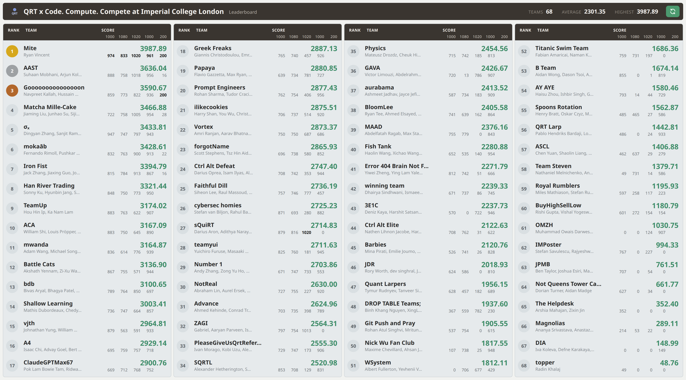
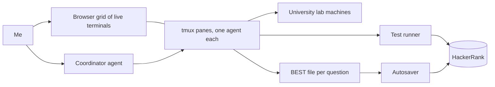
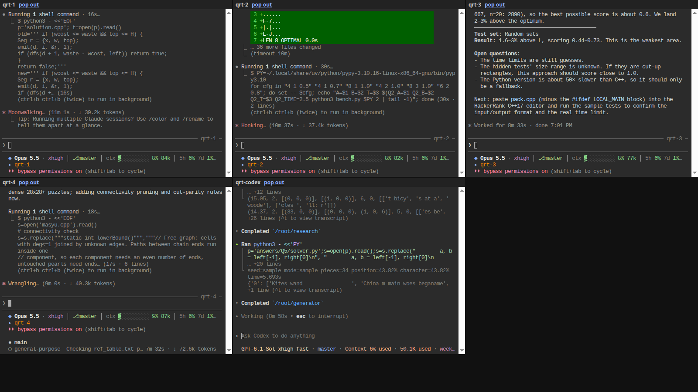
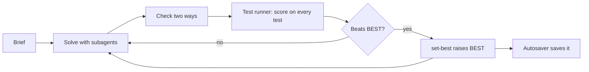
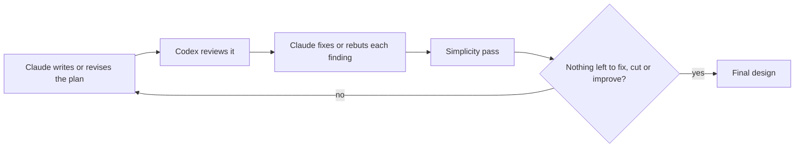

# QRT x Code. Compute. Compete: 1st place, team Mite

On Monday 26 October 2026 I won the QRT x Code. Compute. Compete hackathon at Imperial College London, competing
solo as team Mite: 1st of 68 teams and about 240 participants, with 3987.89 of a possible 4300 points. The test ran
for two hours on HackerRank: four optimisation problems and a bonus.



*A recreation of the final leaderboard as it was shown on screen at the event, redrawn from
[this photo of the screen](img/leaderboard-photo.jpg).*

I wrote very little of the code by hand. Instead I was typing for the whole two hours, steering the AI agents that
wrote it. For each problem I told them how I thought it should be approached and gave them my intuition for the best
way to solve it. I was also the orchestrator: I decided what each agent worked on, where the compute went, what got
merged and what got saved.

I ran a fleet of these agents, one or more per question. This repo has the final submitted code for all five
questions and an account of how it was done.

The problem statements are in [QUESTIONS.md](QUESTIONS.md). Interactive versions of Q1, Q2, Q4 and Q5, which run the
solvers in the browser on your own input, are in [docs/](docs).

## How the points worked

Every question ran on hidden tests and paid partial credit per test, for how good the answer was, not just whether it
was valid. An invalid answer scored 0 on that test.

- **Q1. Square packing** (100 tests, 10 points each, max 1000). Place squares with integer sides on a grid without
  overlaps so the bounding rectangle has the smallest area. A test scores 10 × (L/A)^20, where A is the area of your
  rectangle and L a lower bound: the smallest rectangle that could hold the squares' total area and the largest
  square. L/A is 1 for a perfect packing, and the 20th power makes waste expensive: 1% more area than L keeps 82% of
  the points, 5% more keeps 38%.
- **Q2. Word search generation** (18 tests, 60 points each, max 1080). Build the smallest N × N letter grid,
  wrapping at the edges, that contains every required word and none of the forbidden words. A test scores
  60 × min(1, density / 1.7), where density is the total letters of the required words divided by N². Full marks
  need each cell shared by 1.7 words on average.
- **Q3. Black box** (51 tests, 20 points each, max 1020). Each test gives a number t; the program returns a list of
  numbers and gets a noisy payoff. A test scores 20 × (payoff / best possible payoff), clipped to 0 to 1.
- **Q4. Masyu** (100 tests, 10 points each, max 1000). Draw one closed loop through a grid that visits every pearl
  and obeys the pearl rules; shorter loops score more. A test scores 10 × quality × speed. Quality is
  min(1, s × L_ref / L)², where L is your loop's length and L_ref the shortest known loop. On most tests s = 1; on 27
  large tests where L_ref was only the organisers' best, s = 0.9, so matching L_ref earns 81%. Speed is 1 for the
  first second of runtime and falls slowly after.
- **Q5. Bonus: document reassembly** (1 test, max 200). Put shredded pages of text back together. The score is 200 ×
  the share of the pages' characters, spaces excluded, placed correctly. It counts only if every main question
  scores at least 70%.

The maximum total is 4300: 4100 from the four main questions plus the 200 bonus.

## Result

| Place | Team | Score (of 4300) |
|---|---|---|
| 1 | Mite (solo) | 3987.89 |
| 2 | AAST | 3636.04 |
| 3 | Goooo...oon | 3590.67 |

The average team scored 2301.35. Prize: AirPods Pro with QRT branding, and a fast track to interview for QRT's quant
developer and quant research roles.

| Question | Score | Max | Share | Code |
|---|---|---|---|---|
| Q1 Square packing | 973.68 | 1000 | 97.4% | [solutions/q1](solutions/q1) |
| Q2 Word search generation | 833.40 | 1080 | 77.2% | [solutions/q2](solutions/q2) |
| Q3 Black box | 1020 | 1020 | 100% | [solutions/q3](solutions/q3) |
| Q4 Masyu | 960.81 | 1000 | 96.1% | [solutions/q4](solutions/q4) |
| Q5 Bonus: document reassembly | 200 | 200 | 100% | [solutions/q5](solutions/q5) |
| Total | 3987.89 | 4300 | 92.7% | |

Mite was the only team with perfect scores on both Q3 and Q5, and had the highest or tied highest score on every
question.

## The setup



- **Agents.** 22 sessions over the two hours: 15 Claude Code sessions on Claude Opus 5.5 and 7 Codex sessions on
  GPT-6.1-Sol and GPT-6 Astra. Besides the solvers, a research agent looked for prior work and a black box prober
  worked on Q3.
- **One tmux pane per agent.** Each pane was also served as a web terminal (ttyd), and one browser page tiled them
  all, so I watched every agent live and could type into any of them.
- **Coordinator.** One more agent took my instructions, wrote the briefs and watched the panes.
- **Test runner.** A script that submitted a file to HackerRank and returned the score and stderr of every test,
  hidden tests included, in 15 to 90 seconds.
- **Extra compute.** I SSH'd into my university's lab machines and ran search jobs there.
- **Saving.** Each question had one BEST file, raised by [`tools/set-best`](tools/set-best) only when a score was
  higher. An autosaver kept the code saved on HackerRank in line with it.



*The grid page at 19:01, eleven minutes after the test opened.*

Every agent followed the same protocol file (CLAUDE.md for Claude Code, AGENTS.md for Codex): restate the problem,
attack it with parallel subagents, check the answer two ways, measure it on every test, and raise BEST only on a
higher score.



### How the agent loop was designed

The loop above was designed with a review loop between two AI models. That review loop applied to the setup only,
not to the question solutions. Claude writes the plan and Codex reviews it, looking for bugs, failure modes and
security holes. Claude then reviews that review: it fixes each finding that holds, writes down why it rejects the rest,
and sends the revised plan back to Codex. A simplicity pass also looks for anything that can be cut. The loop stops
only when Codex approves with no material findings, the simplicity pass finds nothing to cut and Claude finds nothing
left to improve; in my experience that catches almost every edge case.



## Capture, solve offline, ship a table (Q1, Q2, Q4)

1. The first submission prints its input to stderr. The test runner returns stderr for hidden tests too, so one run
   captured every hidden input. [`tools/capture.py`](tools/capture.py) is a cleaned version.
2. Solve each captured input offline for minutes instead of 2 seconds, on the lab machines.
3. Submit the live solver plus a lookup table: a hash of the input maps to the stored answer, and any other input
   goes to the live solver.

The live solvers alone scored 68% (Q1), 62% (Q2) and 92% (Q4). The tables took them to 97%, 77% and 96%.

## Timeline

| Time | Milestone |
|---|---|
| 18:50 | Test opens |
| 19:04 | Hidden inputs captured for Q1, Q2 and Q4 |
| 19:19 | All four main questions at 70% or more, so the bonus counts |
| 19:26 | Q3 at 100% |
| 19:37 | Q5 at 100% |
| 20:38 | Last improvement: Q2 to 77% |
| 20:50 | Test closes |

## Per question

Only Q3 and Q5 reached full marks. The Q1, Q2 and Q4 solutions are not optimal: they are the best I came up
with in the two hours.

### Q1. Square packing: 97.4%

**Key insight.** In every hidden test the total area factored into a rectangle that fits the largest square, so L
was the total area itself and a perfect tiling might exist. Finding one takes far more than 2 seconds of search.

**Final algorithm.** A skyline depth first search: fill the lowest, leftmost gap, try sizes largest first, prune with
a subset sum check on gap widths and wasted space bounds, and try boxes in order of area. Offline, this search and two
CP-SAT models ran on the lab machines, and a merge kept the smallest verified area per test.

**Left.** 48 of 100 tests got a perfect packing (A = L). The other 52 lost 26.3 points, and only one of them is
proven optimal. [Details](solutions/q1).

### Q2. Word search generation: 77.2%

**Key insight.** The short forbidden words ban most letter pairs: only 2 to 5 letters per test appear in no forbidden
word. SAT and CP-SAT never produced a single new grid. Every gain came from annealing.

**Final algorithm.** Simulated annealing over word placements. Each step removes one word and samples a new placement
from all 8·N² options at once, weighted by an energy that penalises letter conflicts and banned pairs and rewards
shared letters. It solves at an easy N, then shifts the solution to N - 1 and anneals again. Thousands of offline
jobs ran on the lab machines, and a harvester kept the smallest valid grid per test.

**Left.** 246.6 points, the largest gap of any question. The final grids had densities of 1.15 to 1.56 against the
1.7 needed for full marks. One size smaller on every test would have added 87.4 points. [Details](solutions/q2).

### Q3. Black box: 100%

**Key insight.** The score was computed from the noiseless payoff, so every probe with a positive payoff was an exact
measurement. Probing showed the output is read as a step function f on [0, 1], and the payoff is
`mean(g·f) - 0.5·mean(f²)` for a hidden curve g, best at f = g.

**Final algorithm.** Measure g one Fourier coefficient at a time, with probes small enough to keep the payoff
positive. About 150 runs in 11 minutes, each total predicted before it ran. The submission is a table of 51 × 101
measured coefficients. [Details](solutions/q3).

### Q4. Masyu: 96.1%

**Key insight.** Finding a valid loop fast and finding the shortest loop are different problems. The live solver
does the first in under a second; exact CP-SAT does the second offline.

**Final algorithm.** Live: edge state propagation (cell degrees, pearl rules, cut parity), depth first search with
connectivity checks, then large neighbourhood search for shorter loops. Offline: CP-SAT with `AddCircuit`, warm
started from the live solver's loops.

**Left.** 39.19 points, all on the 27 tests with s = 0.9. 26.63 of them could not be reached: those loops are proven
shortest, so s caps them. The practical ceiling was about 964 of 1000. [Details](solutions/q4).

### Q5. Bonus, document reassembly: 100%

**Key insight.** Solvers that score the seams between pieces reached 20 to 26% on synthetic cases: 190 of the 457
pieces are a single row of 3 to 7 characters, which says little about their neighbours. Reading beat search.

**Final algorithm.** Codex subagents read the pieces as English and wrote each page out a row at a time. An exact
tiling search checked every row against the unused pieces, so a wrong word or line break failed at once. Six pages
came out, from the Sahara to a chicken curry recipe. [Details](solutions/q5).

## Lessons

- Build the feedback loop first. A runner that scored any file on every hidden test in about a minute let each agent
  measure its own work, and it is what made capturing the hidden inputs possible.
- On a black box, find the noiseless signal before fitting anything. On Q3, fitting the noisy numbers reached 67% in
  15 minutes; the exact route reached 100% in 11.
- Capture early, solve offline, ship a table with a live fallback.
- Independent searches, merged per test, beat one bigger search. The final Q2 improvement came from an agent that
  never saw our work.

## Repo

```
QUESTIONS.md         the five problem statements, with diagrams redrawn from the examples (questions/img)
solutions/q1 .. q5   the final submitted code, unchanged, each with a README (approach, build, run)
tools/set-best       write a score file only if the new score is higher (flock + atomic rename)
tools/capture.py     recover inputs that a submission echoed to stderr
LINKEDIN.md          draft posts
img/leaderboard.png  the final leaderboard, redrawn from leaderboard-photo.jpg (the photo at the event, straightened)
tools/leaderboard/   every row read from the photo (leaderboard.json) and render.py, which checks them and draws the png
img/pane-grid.png    screenshot of the browser grid of agent terminals
docs/                interactive pages for Q1, Q2, Q4, Q5: the solvers in WebAssembly and Pyodide (docs/build.sh)
docs/code/           each solution highlighted for the pages' Show code pane (rerun tools/highlight-code.py)
tools/notes/         what each block of each solution does, shown on hover in the Show code pane
docs/q3/             the Q3 animation (anim.js) and its data, from the night's probe logs (data.py lists the sources)
docs/fonts/          iA Writer Quattro and Mono, unmodified, SIL Open Font License (OFL-iAWriter.md)
```

The captured hidden inputs are not included: they are QRT's test data. On any other input each program runs its live
solver or fallback. Every C++ file builds with `g++ -std=c++20 -O2` (Q2 with `-std=c++23`), and each solution's
README has a run example.
