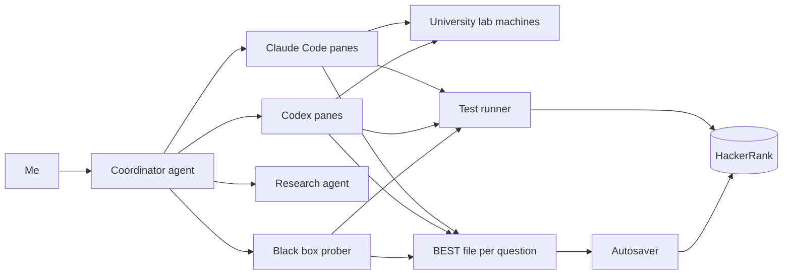

# QRT x Code. Compute. Compete: 1st place, team Mite

On Monday 26 October 2026 I won the QRT x Code. Compute. Compete hackathon at Imperial College London, competing
solo as team Mite: 3987.89 points, 1st of 68 teams. The test ran on HackerRank from 18:50 to 20:50, with four
optimisation problems and a bonus.

I wrote very little of the code by hand. I ran a fleet of AI coding agents, one or more per question, and spent the
two hours deciding what they worked on, where the compute went, what got merged and what got saved. This repo has
the final submitted code for all five questions and an account of how it was done.

## Result

| Place | Team | Score |
|---|---|---|
| 1 | Mite (solo) | 3987.89 |
| 2 | AAST | 3636.04 |
| 3 | Goooo...oon | 3590.67 |

68 teams, field average 2301.35, winning margin 351.85. Prize: AirPods Pro.

| Question | Score | Max | Code |
|---|---|---|---|
| Q1 Square packing | 973.68 | 1000 | [solutions/q1](solutions/q1) |
| Q2 Word search generation | 833.40 | 1080 | [solutions/q2](solutions/q2) |
| Q3 Black box | 1020.00 | 1020 | [solutions/q3](solutions/q3) |
| Q4 Masyu | 960.81 | 1000 | [solutions/q4](solutions/q4) |
| Q5 Bonus: document reassembly | 200.00 | 200 | [solutions/q5](solutions/q5) |
| Total | 3987.89 | 4300 | |

The bonus only counted if every main question scored at least 70%. All four were over that line by 19:19.

## The setup



- **Agents.** 22 agent sessions over the two hours: 15 Claude Code sessions on Claude Opus 5.5 and 7 Codex sessions
  on GPT-6.1-Sol and GPT-6 Astra, several with subagents of their own. Each ran in its own terminal pane with one
  question and one directory. At the start: two Claude panes on Q1 with different methods, one each on Q2 and Q4,
  and a Codex pane on Q5.
- **Coordinator.** One more agent took my instructions, wrote the briefs, ran shared tools and watched the panes.
- **Research agent.** Looked for prior work while the solvers started. It found the previous round's public Q3 code,
  AtCoder AHC004 (placing strings on a torus) for Q2, cut parity rules for Masyu and the Huang and Korf packing
  bounds for Q1.
- **Black box prober.** A Claude pane whose only job was to submit probes and read the feedback. It solved Q3, then
  checked Q5.
- **Test runner.** A script that submitted a file through a browser tab logged in to my account and returned the
  score and stderr of every test, hidden tests included, in 15 to 90 seconds. Over 200 runs were saved.
- **Offline compute.** Search jobs fanned out over university lab machines, up to 4,665 CPU cores at 20:10,
  with a cap on threads and memory per machine.
- **Handoff and saving.** Each question had one BEST file naming the best measured score and its file. Agents wrote
  to it with [`tools/set-best`](tools/set-best), which only accepts a higher score. An autosaver compared the code
  saved on HackerRank with the BEST file every 20 seconds and saved again when they differed.

## The pattern behind Q1, Q2 and Q4

1. The first submission prints its input to stderr. The test runner returns stderr for hidden tests too, so one run
   captured every hidden input (19:04 for all three questions). [`tools/capture.py`](tools/capture.py) is a cleaned
   version.
2. Solve each captured input offline for minutes instead of 2 seconds, on the lab machines.
3. Submit the live solver plus a lookup table: a hash of the input maps to the stored answer, and any input not in
   the table goes to the live solver.

The rules from the opening presentation allowed this: "Submitting optimised solutions is allowed; full code not
required" and "Any online information may be consulted". The live solvers alone scored 682.09
(Q1), 665.1 (Q2) and 916.72 (Q4). Without the tables, Q1 and Q2 would have missed the 70% line and the bonus with
them.

## Timeline

| Time | Event |
|---|---|
| 18:50 | Test opens. Briefs go to five panes within 3 minutes |
| 19:02 | Test runner ready |
| 19:04 | Hidden inputs captured for Q1, Q2, Q4. First scores: Q4 916.72, Q1 648.87, Q2 91.02 |
| 19:17 | Q2 773.70, the first lookup table |
| 19:19 | All four main questions over 70% |
| 19:26 | Q3 1020 / 1020 |
| 19:29 | Q1 932.28, from merging three agents' tables |
| 19:37 | Q5 200 / 200 |
| 19:45 to 20:05 | Server out of memory: no test run completes for 20 minutes |
| 20:10 | Q4 960.81 (final). Lab machines at 4,665 cores |
| 20:12 | Every Codex login wiped; Codex panes stop for 6 minutes |
| 20:31 | Q1 973.68 (final) |
| 20:38 | Q2 833.40 (final), with one grid from an independent agent |
| 20:39 | Last save |
| 20:50 | Test closes |

## Per question

### Q1. Square packing: 973.68 / 1000

**Problem.** Place a list of squares with integer sides on a grid without overlaps, so that the bounding rectangle
has the smallest area. 100 hidden tests of 14 to 48 squares, sides 2 to 60.

**Scoring.** Per test 10 × (L/A)^20, where A is the rectangle's area and L a lower bound from the total area and
the largest side. The 20th power is harsh: 1% too much area keeps only 82% of the points.

**Key insight.** In every hidden test the total area factored into a rectangle that fits the largest square, so L
was the total area itself and a perfect tiling might exist. Finding one takes far more than 2 seconds of search.

**Final algorithm.** A skyline depth first search: fill the lowest, leftmost gap, try sizes largest first, prune with
a subset sum check on gap widths and wasted space bounds, and try candidate boxes in order of area with iterative
deepening. Offline, three solver families ran on the lab machines: this search in shards, CP-SAT (fix the width,
minimise the height) and a CP-SAT ladder of box shapes descending towards L. A merge kept the smallest verified area
per test, and the submission embeds all 102 packings in 30 KB.

**Left.** 48 of 100 tests reached A = L. The other 52 lost 26.3 points, and only one of them was proven optimal.
At the end the search was limited by free cores. [Details](solutions/q1).

### Q2. Word search generation: 833.40 / 1080

**Problem.** Build the smallest square letter grid that contains every required word in a straight line in any of 8
directions and no forbidden word anywhere, with the grid wrapping at the edges. The 18 hidden tests were themed lists
(London stations, dinosaurs, cheeses and others) of 65 to 92 words, each with 59 forbidden words of mostly 2 or 3
letters.

**Scoring.** Per test 60 × min(1, density / 1.7), where density is the letters of the required words over N². Any
violation scores 0, and full marks need each cell shared by 1.7 words on average.

**Key insight.** The short forbidden words ban most letter pairs: only 2 to 5 letters per test appear in no forbidden
word. Four agents tried SAT and CP-SAT on this and none produced a single new grid. Every gain came from annealing.

**Final algorithm.** Simulated annealing over word placements. Each step removes one word and samples a new
placement from all 8·N² options at once, weighted by an energy that penalises letter conflicts (with weights that
grow on stubborn cells), rewards shared letters and penalises banned pairs. It solves at an easy N, then shifts the
solution to N-1 and anneals again. Offline, thousands of annealing jobs ran on the lab machines with sampled
settings, and a harvester kept the smallest valid grid per test. The submission embeds 18 grids, with the live
annealer and an always valid fallback behind them.

**Left.** 246.6 points, the largest gap of any question. One size smaller on every test would have added 87.4. The
last gain came from an independent GPT-6 Astra session that had test 18 one size smaller than ours (+4.44).
[Details](solutions/q2).

### Q3. Black box: 1020 / 1020

**Problem.** The statement said almost nothing: query a black box, maximise a payoff, expect noise. Each of 51 tests
gives a number t, and the program returns a list of numbers.

**Scoring.** Up to 20 points per test. The feedback showed a noisy payoff, the best achievable payoff (the target),
their ratio, and the score.

**Key insight.** The score field did not follow the noisy numbers. One probe at t = 0.80 had a negative noisy payoff
and a ratio of 0, yet scored 1.96. The score came from the noiseless payoff, so every probe with a positive payoff
was an exact measurement, rounded to 0.02 points. Probing then showed the shape: the output is read as a step
function f on [0, 1], and the payoff is `mean(g·f) - 0.5·mean(f²)` for a hidden curve g, best at f = g.

**Final algorithm.** Measure g one Fourier coefficient at a time. A probe along one basis vector, scaled to a tenth
of g's size (known from the target), keeps the payoff positive and reads that coefficient from the score alone. 42
probes on the first 21 modes gave 1011.66, then 100 residual probes, one per basis vector, gave 1020: about 150 runs
in 11 minutes. Each total was predicted before it ran (989.92 predicted, 989.58 measured at 11 modes). The
submission is a table of 51 × 101 measured coefficients.

**Left.** Nothing. The noisy feedback on this perfect answer read as 758.5 points, and the first 15 minutes, spent
fitting the noisy field with probes too large to score above 0, reached 686.92. [Details](solutions/q3).

### Q4. Masyu: 960.81 / 1000

**Problem.** Masyu is a logic puzzle: on grids of up to 50 × 50, draw one closed loop through cell centres that
visits every pearl, goes straight through white pearls and turns on black ones, with extra rules on the next cells.
Shorter loops score more. 100 hidden tests.

**Scoring.** Per test 10 × quality × speed, with quality = min(1, s × L_ref / L)² against the shortest known loop
L_ref. On 27 large tests s = 0.9: matching the reference earns 81%, and full marks need a loop 10% shorter.

**Key insight.** Finding a valid loop fast and finding the shortest loop are different problems. The live solver
does the first in under a second; exact CP-SAT does the second offline.

**Final algorithm.** Live: edge state propagation (cell degrees, pearl rules, cut parity), depth first search with
connectivity checks, then large neighbourhood search that re-solves random windows for shorter loops until 0.85 s.
It scored 916.72 alone. Offline: CP-SAT with `AddCircuit`, warm started from the live solver's loops, cropped to the
pearls' bounding box on large grids. The submission stores each loop as 2 bits per step, 103 loops in 28 KB.

**Left.** 39.19 points, all on tests with s = 0.9. 26.63 of them cannot be reached (15 tests proven optimal and capped
by s), 7.97 sit on tests proven optimal inside the crop, and at most 3.25 were open. The practical ceiling was about
964. [Details](solutions/q4).

### Q5. Bonus, document reassembly: 200 / 200

**Problem.** A few pages of English text, each wrapped to its own width, were cut into rectangles, shuffled and
mixed with pieces of another document. Put the pages back together. One hidden test, 457 pieces, worth all 200
points.

**Scoring.** The share of the pages' characters (spaces excluded) placed correctly, with pages matched one to one and
free to shift.

**Key insight.** General solvers that score the seams between pieces reached 20 to 26% on synthetic cases: 190 of the
457 pieces are a single row of 3 to 7 characters, which says little about their neighbours. Reading beat search.

**Final algorithm.** Capture the input. Codex subagents read the pieces as English and wrote each page as a fixed
width template, a row at a time. An exact tiling search checked every row against the unused pieces, so a wrong word
or line break failed at once. Six pages came out (the Sahara, the Silk Road, Edison's light bulb, the Renaissance, a
chicken curry recipe, a CI pipeline): 451 pieces and 2,963 characters, plus 6 pieces from the other document. The
submission is a 3.5 KB table keyed by a hash of the input.

**Left.** Nothing. [Details](solutions/q5).

## What went wrong and what I'd change

1. **The server ran out of memory, 19:46 to 20:05.** About 37 agent processes, local solver runs and unrelated jobs
   shared one machine with 16 cores and 31 GB. The kernel's out of memory killer ended 10 Chrome processes,
   including the tab that ran tests and saved code. No test run completed for 20 minutes 24 seconds, a sixth of the
   test, and nothing could be saved for 11 minutes. Next time: stop everything unrelated before the start, protect
   the browser from the killer or run it on its own machine, cap the number of agents, and alert when free memory
   falls under 3 GB.
2. **Codex usage ran out within the hour.** Four Codex panes ran the fastest tier at the highest reasoning setting
   with three subagents each, about 5% of a weekly allowance per minute. One allowance went from 13% to 99% between
   19:29 and 20:01, a second from 0% to 100% between 20:03 and 20:32. Next time: check minutes left × panes × rate
   against the allowance before launch, with 20% spare, and use the default tier for long searches.
3. **One logout wiped every Codex login, 20:12.** An idle Codex window that had already hit its limit sent a logout;
   I never found out what triggered it. Codex keeps one shared login file, and a logout deletes it and invalidates the
   login on the server, so three working Codex sessions stopped until 20:18. Next time: a separate config directory per session,
   close a session as soon as its allowance is spent, and keep the terminal viewer read only.
4. **Three different deadlines.** At 19:28 the agents were told about 20:49. At 19:56 I said 20:55, with saves by
   20:52, and that went into every brief. At 20:13 HackerRank's own timer read 20:50:03. For 17 minutes every plan
   aimed 5 minutes past the real close, and the last search round and the final merge had to be pulled forward. No
   points were lost (last save 20:39). Next time: read the platform's timer once at the start, write the absolute end
   time into the shared instructions, and change it only from the timer.
5. **A merge script skipped a file format.** The independent Astra session stored its Q2 grids with a header line,
   which our merge silently rejected. Its better test 18 grid existed from 20:25 and reached HackerRank at 20:39,
   after a comparison by hand. Next time: one shared result format, and a merge that prints how many results it took
   from each source.

## Lessons

- The feedback loop is the bottleneck. One browser tab carried every test run and every save, and when it died no
  agent could measure anything. Protect it first.
- On a black box, find the noiseless signal before fitting anything. On Q3 the noisy route took 15 minutes to reach
  687; the exact route took 11 minutes to reach 1020.
- Capture early, solve offline, ship a table with a live fallback. Every first submission should print its input.
- Independent searches, merged per test, beat one bigger search. The final Q2 grid came from an agent that was not
  allowed to read our work.
- Exact solvers won Q1 and Q4 and never helped on Q2. Give them a time limit and move on.
- A BEST file that only goes up, plus an autosaver, meant the saved answer never went backwards and nothing depended
  on someone remembering to press save.
- Send spare agents to the biggest gap. Late on, three agents rebuilt the same Q1 table (11.3 points in 50 minutes)
  and four worked Q4 after 20:10 for no gain, while Q2 still had 246.6 points open.

## Repo

```
solutions/q1 .. q5   the final submitted code, unchanged, each with a README (approach, build, run)
tools/set-best       write a score file only if the new score is higher (flock + atomic rename)
tools/capture.py     recover inputs that a submission echoed to stderr
LINKEDIN.md          draft posts
```

The captured hidden inputs are not included: they are QRT's test data. The tables in the solutions only match those
inputs, so on any other input each program runs its live solver or fallback. Every C++ file builds with
`g++ -std=c++20 -O2` (Q2 with `-std=c++23`), and each solution's README has a run example.
